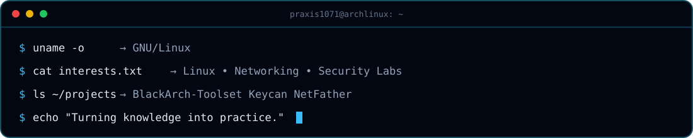

### Hi, I'm Mehmet.

Computer Technologies student based in Türkiye. I enjoy exploring Linux, understanding networks, experimenting in security labs, and building open-source software.

## ⌁ FEATURED PROJECTS

## ⌁ AREAS OF INTEREST

  

  

 

Curiosity-driven learning · Authorized testing only · Open-source mindset

